<p align="center">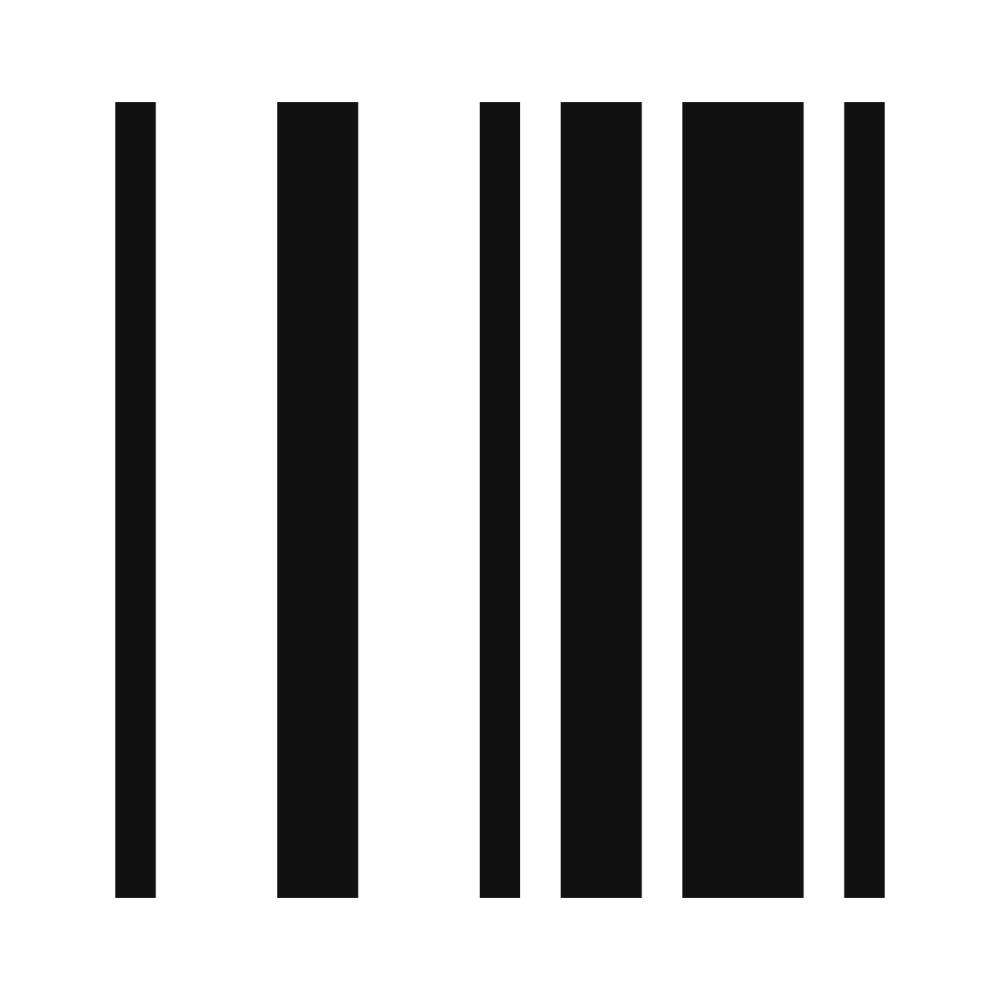</p>

<h1 align="center">Fab Shop</h1>

<p align="center">
Quoting, job tracking, and invoicing for small custom, ornamental, and mobile metal fabrication and welding shops (1-8 people).<br>
Replaces the QuickBooks + spreadsheets + paper-traveler status quo.
</p>

<p align="center">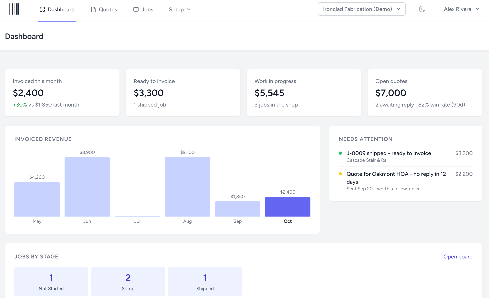</p>

## What it does

| Area | Summary |
| --- | --- |
| **Customers & catalog** | Customers, materials, services, business partners (per-partner pricing), equipment, tooling, and material types. CSV import for all of them. |
| **Quote builder** | Material, labor, equipment, and tooling lines with per-type markup defaults, a change log, PDF generation, and email to the customer. |
| **Quote-to-job** | A won quote becomes a trackable job; price is fixed to the quote. |
| **Job board** | Shop-configurable stages, live updates over WebSockets, optional drag-and-drop, a kiosk mode for a shop-floor display, assignments, and photos. |
| **Material & scrap tracking** | Append-only ledger of actual material used and scrapped, compared against the quote's estimate. |
| **Qualification records** | Procedures, per-person certifications, and a job-level record of who was qualified when work was performed. |
| **QuickBooks Online sync** | OAuth connection, customer dedupe, invoice push on reaching the Invoiced stage, retry on failure. |
| **Plans & add-ons** | Tiered plans with a 14-day trial, per-feature gating, and standalone add-ons. |
| **Team & permissions** | Owner / Admin / Staff roles per shop, with per-resource permissions and per-member overrides. |
| **Platform admin console** | Internal cross-tenant tool to view shops, change plans, and suspend. |

## Screenshots

<table>
  <tr>
    <td width="50%">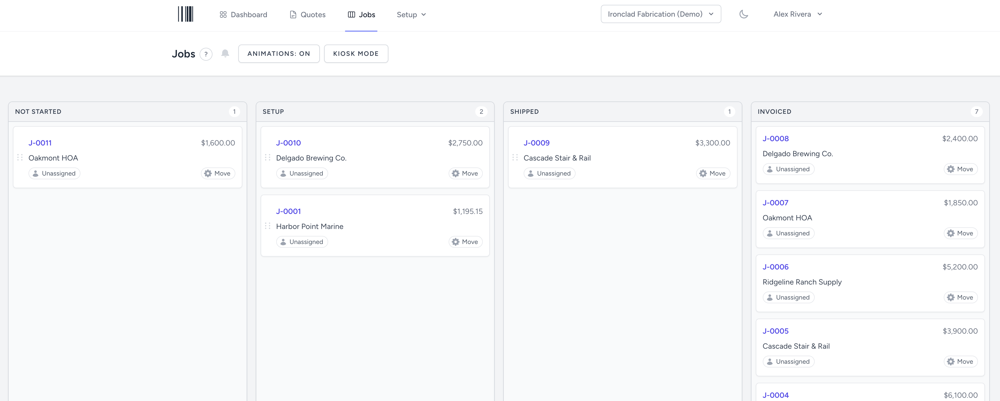<br><sub><b>Job board</b> - configurable stages, live updates</sub></td>
    <td width="50%">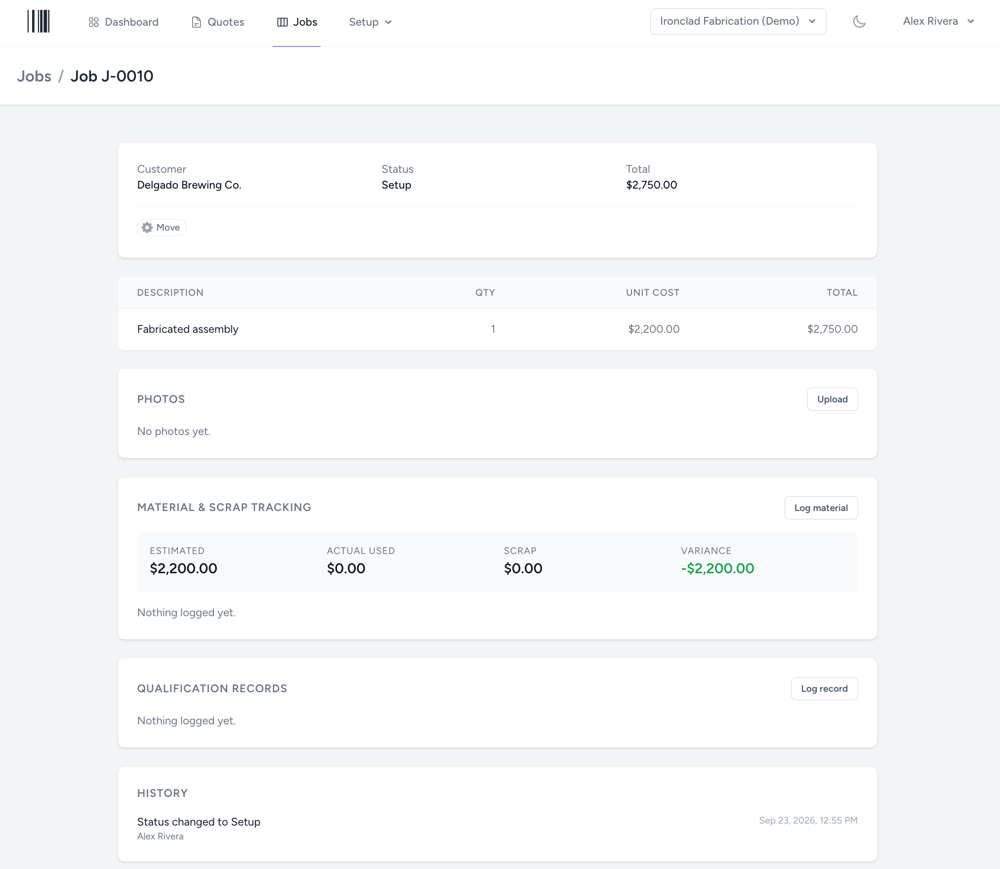<br><sub><b>Job details</b> - material and scrap tracking, history</sub></td>
  </tr>
  <tr>
    <td>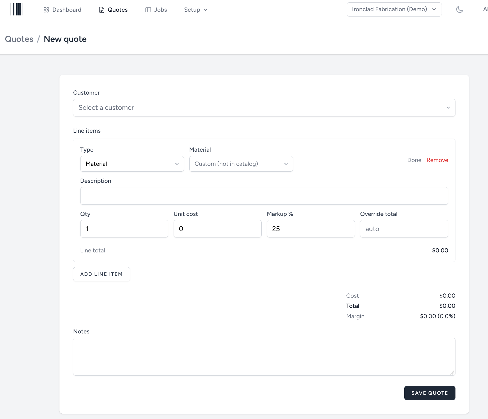<br><sub><b>Quote builder</b> - catalog-driven lines with markup</sub></td>
    <td>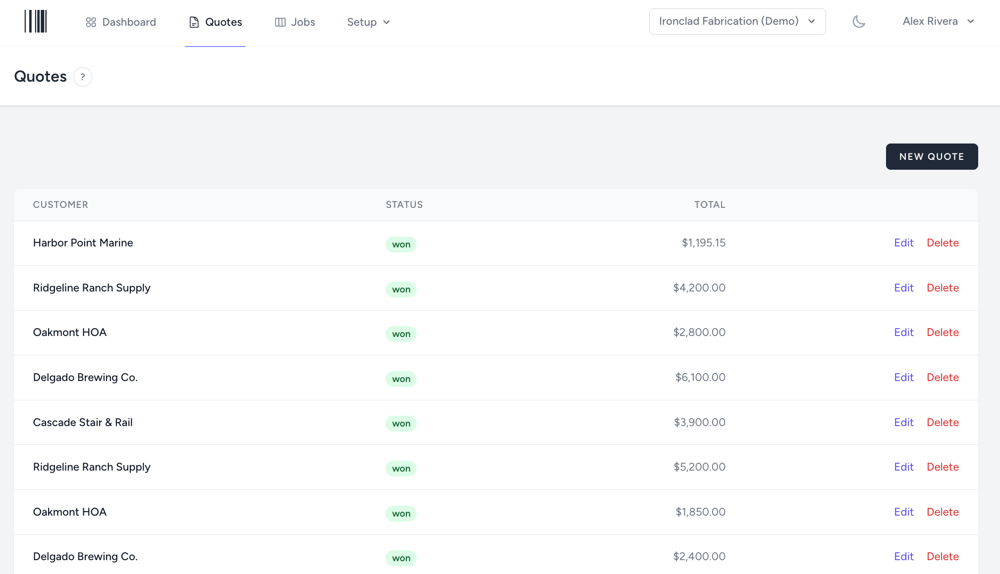<br><sub><b>Quotes</b> - open, stale, won, and lost</sub></td>
  </tr>
  <tr>
    <td>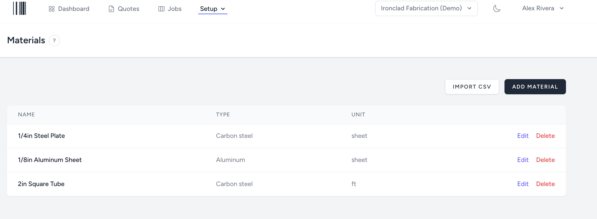<br><sub><b>Materials catalog</b></sub></td>
    <td>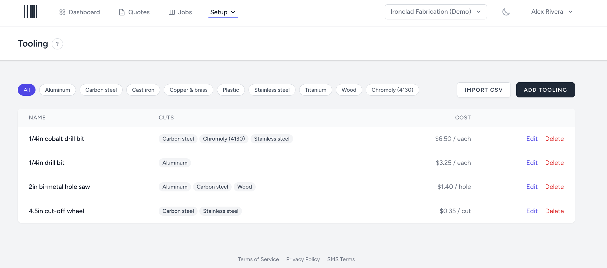<br><sub><b>Tooling</b> - rated per material type</sub></td>
  </tr>
  <tr>
    <td>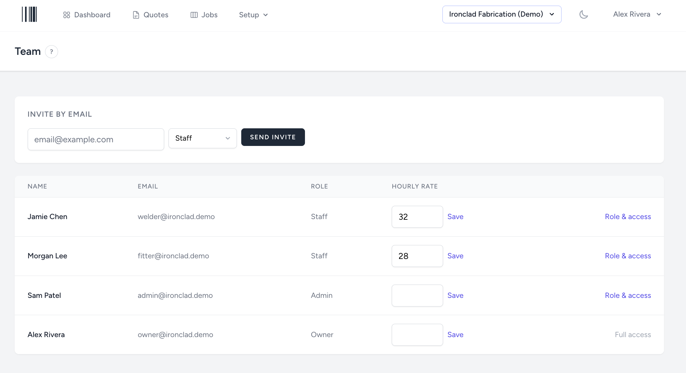<br><sub><b>Team</b> - invites, roles, and rates</sub></td>
    <td>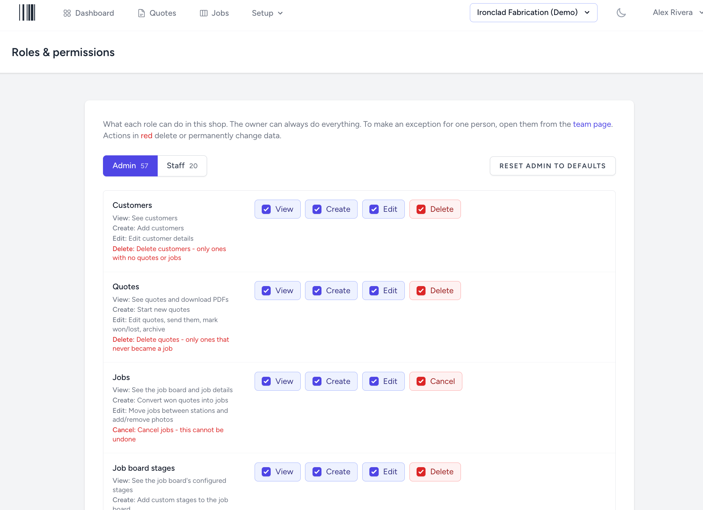<br><sub><b>Permissions</b> - per resource and action</sub></td>
  </tr>
  <tr>
    <td>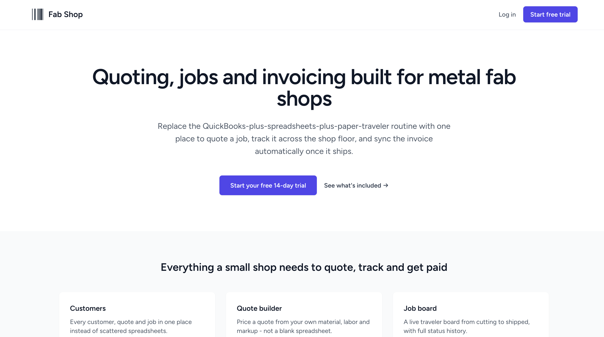<br><sub><b>Marketing page</b></sub></td>
    <td>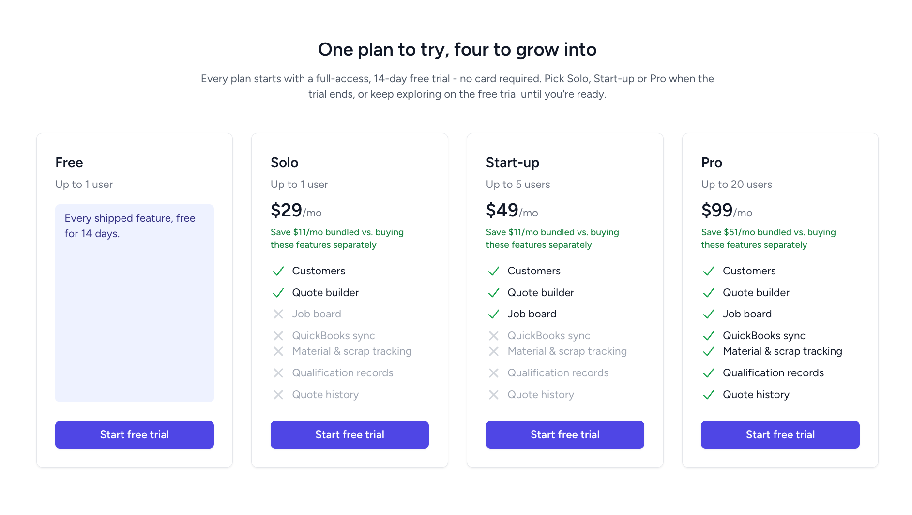<br><sub><b>Pricing</b> - read live from the plan data</sub></td>
  </tr>
</table>

## Architecture

A single Laravel monolith with a server-driven React frontend. There is no separate SPA router or API layer; Inertia passes controller data to React pages as props.

```
Browser (React + TypeScript + Tailwind, Inertia)
   |  HTTP (Inertia visits)            ^  WebSocket (Laravel Echo)
   v                                   |
Laravel 13 app  ------ broadcast ----> Reverb
   |   |        \
   |   |         `--- queue ---> Redis ---> Horizon workers
   |   |                                     - quote PDF generation + email
   |   |                                     - CSV import processing
   |   |                                     - QuickBooks invoice push
   |   `--- scheduler (hourly trial-expiry notices)
   v
PostgreSQL (single database, shared schema, every tenant table has shop_id)

Node SSR renderer  <-- Laravel POSTs the public pages' props (marketing, legal) so search
                       engines get real HTML; optional - pages fall back to client rendering
```

### Stack

- **Backend:** Laravel 13, PHP 8.3+
- **Frontend:** Inertia.js, React, TypeScript, Tailwind CSS, `@dnd-kit` for board drag-and-drop
- **Database:** PostgreSQL
- **Queues:** Redis, supervised by Laravel Horizon
- **Real time:** Laravel Reverb (job board updates)
- **Auth and access:** Laravel session auth, email verification, Spatie Permission (roles per shop), Spatie Activity Log (history), Spatie Media Library (job photos)
- **Testing and style:** Pest against a real Postgres database, Pint

### Key design decisions

- **Multi-tenancy.** One database, one schema. Every tenant-owned table carries `shop_id`, and isolation is enforced only through the `BelongsToShop` trait and its Eloquent global scope, keyed off the user's current shop. Users can belong to several shops and switch between them. Every tenant-owned model has a cross-tenant isolation test.
- **Permissions.** Access is `{resource}.{action}`, resolved as: Owner has everything, otherwise the role's grants, then per-member overrides. Each permission is also a Gate ability. Financial data is withheld on the server, not just hidden in the UI.
- **Feature gating.** `Shop::hasFeature()` is the single check, combining the plan, active add-ons, and trial windows. It is enforced by route middleware and mirrored to the frontend only to grey out navigation.
- **Job stages.** Stage lists are per shop and editable. Three fixed roles (not started, shipped, invoiced) drive behavior, never stage names, so renaming a column can't break invoicing.
- **Append-only ledgers.** Material usage, qualification records, and consent records only grow, so reversing a job's status never erases history.
- **Time.** Everything is stored in UTC. Calendar logic goes through the shop's timezone.
- **Integrations.** The QuickBooks client is built on Laravel's HTTP client so its OAuth refresh, dedupe, and retry behavior is tested with `Http::fake()`.

Detailed notes live in [CLAUDE.md](CLAUDE.md) (conventions and gotchas) and [docs/product-desc.md](docs/product-desc.md) (feature design and plans).

## Local development

The app runs under [Laravel Sail](https://laravel.com/docs/sail) (Docker). Use `./vendor/bin/sail` instead of host `php`/`npm`.

```bash
cp .env.example .env
./vendor/bin/sail up -d
./vendor/bin/sail composer install
./vendor/bin/sail artisan key:generate
./vendor/bin/sail artisan migrate --seed
./vendor/bin/sail artisan storage:link
./vendor/bin/sail npm install
./vendor/bin/sail npm run dev
```

| Service | URL |
| --- | --- |
| App | http://localhost |
| Mailpit (outgoing mail) | http://localhost:8025 |
| Horizon (queues) | http://localhost/horizon |

Run tests with `./vendor/bin/sail test`.

### Server-side rendering (optional locally)

The public pages (marketing, legal) are server-rendered in production by a small Node service so search engines get real HTML. Locally there is no renderer by default and those pages render in the browser as usual. To try it: `npm run build:ssr`, then `./vendor/bin/sail artisan inertia:start-ssr`, and load `/` signed out (rebuild after editing a public page). Hosting it on Railway - the `ssr` service, its variables and how to check it - is in [docs/deploy-railway.md](docs/deploy-railway.md#the-ssr-service-public-pages-for-search-engines).

### Demo data

With `APP_MODE=demo` set in `.env`:

```bash
./vendor/bin/sail artisan demo:seed-team --fresh        # one fully populated shop
./vendor/bin/sail artisan demo:seed-multi-shop --fresh  # two shops + a user in both
```

Both print their logins; the password is `password` for every seeded user.

## Status

QuickBooks sync is tested against faked responses but has not been exercised against a real Intuit sandbox. The mobile app and public API (F6) are not built. Billing is simulated; no payment processor is connected.

## License

Proprietary. Copyright (c) 2026 Alexei Yagolnikov. All rights reserved. See [LICENSE](LICENSE); no use without written consent.

Built on the Laravel framework (MIT) and other open-source packages, which remain under their own licenses.
