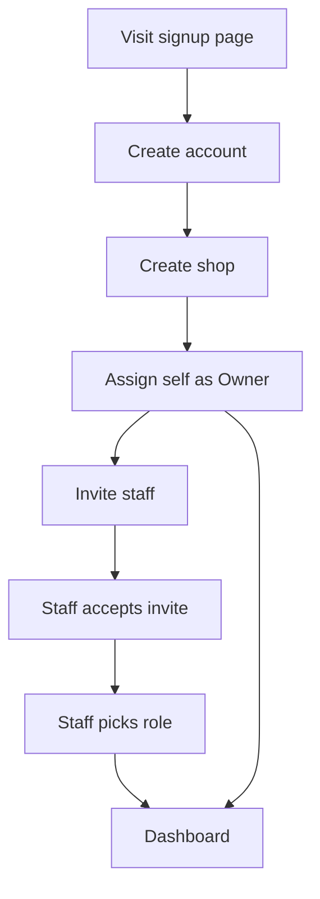
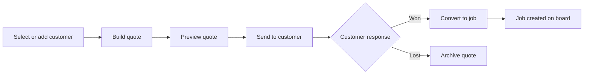
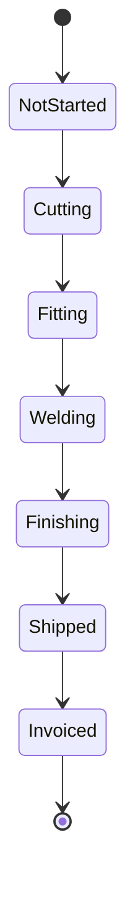
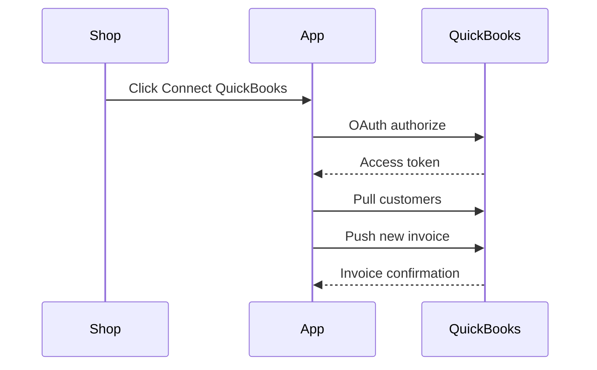
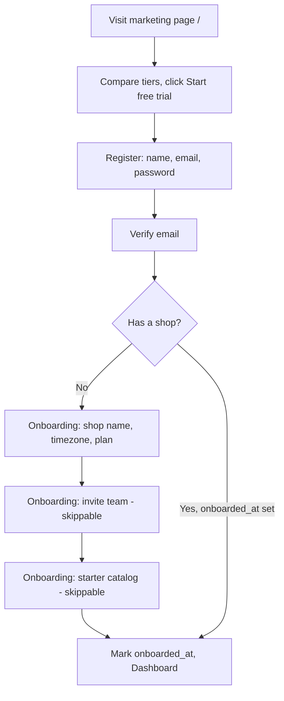
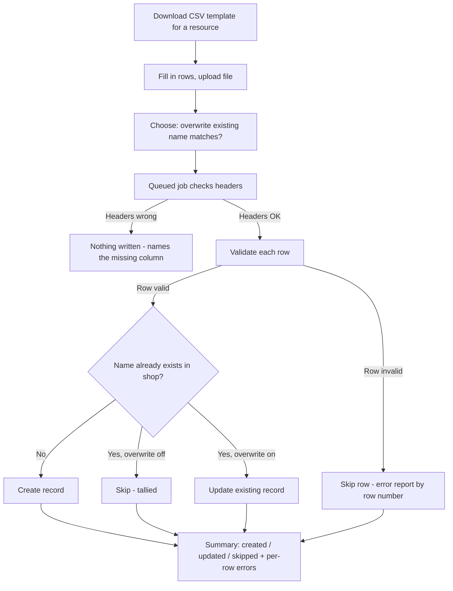

# Build Handoff

A self-contained brief for a fresh session to pick up and implement Scenario B.

## Product

We're building a vertical SaaS quoting, job-tracking, and invoicing tool for small custom/ornamental/mobile metal fabrication and welding shops (1-8 people) - replacing the QuickBooks-plus-spreadsheets-plus-paper-traveler status quo documented in the Pain points tab.

Core features, in plain terms (full dependency table is below):

- **Customers** - contact records that quotes and jobs attach to
- **Quote builder (F1)** - custom quoting with material, labor, and markup
- **Quote builder catalog (F1.1)** - materials and services priced per business partner, equipment costs, per-line-item-type markup defaults
- **Quote-to-job conversion (F2)** - turns a won quote into a trackable job, generates and sends the PDF
- **Job/traveler status board (F3)** - live tracking from cut through ship
- **QuickBooks Online sync (F4)** - customers and invoices sync automatically
- **Subscription billing (F0.8)** - the shop pays for the product itself
- **Material/scrap tracking (F5)** - built; see [Material/scrap tracking](#materialscrap-tracking-f5---built) below
- **Mobile/PWA + API (F6)** - the rest of the Scenario C follow-on, not yet started
- **Qualification records (F7)** - built, generalized beyond welding; see [Qualification records](#qualification-records-f7---built) below
- **Marketing site, tier comparison & guided onboarding (F8)** - built; see [Marketing site, tier comparison & guided onboarding](#marketing-site-tier-comparison--guided-onboarding-f8---built) below
- **CSV import for catalog data (F9)** - built; see [CSV import for catalog data](#csv-import-for-catalog-data-f9---built) below
- **Platform admin console (F10)** - internal, cross-tenant tool to view/administer all shops (plan, suspend, upgrade); dashboard built, see [Platform admin console](#platform-admin-console-f10---dashboard-built-real-revenue-deferred) below

**Dependency shape, in plain terms:** Foundation (accounts, shops, roles) has to exist before anything else - nothing else can start until it's done. Customers have to exist before Quotes can be created. Quotes have to exist before a Quote can become a Job. Jobs have to exist before the status board, material tracking, weld records, or mobile status views have anything to show. Subscription billing and QuickBooks sync are the two features that don't block, or get blocked by, that chain - each can be built independently once its own light prerequisite (the Shop model; stable Customer/Quote data shapes) is in place.

## Tech stack & conventions

- **Backend:** Laravel 13 (PHP 8.3+), one monolithic app.
- **Frontend:** Inertia.js + React + TypeScript, server-driven routing (no separate SPA router). Tailwind CSS for styling.
- **Database:** PostgreSQL. Single database, shared schema - every tenant-owned table carries a `shop_id` foreign key.
- **Tenancy enforcement:** a `BelongsToShop` trait + Eloquent global scope applied to every tenant-owned model, keyed off the authenticated user's *current* shop (`users.current_shop_id`), not their full membership list. Never rely on manually adding `->where('shop_id', ...)` at each call site - the global scope is the one place that guarantees no cross-tenant leak. Write a test early that asserts a user from Shop A cannot read/write Shop B's records, and run it against every new tenant-owned model.
- **Auth:** Laravel's built-in session-based auth for the web app (Breeze's Inertia+React+TypeScript starter kit is the fastest correct starting point - use it rather than hand-rolling login/register/password-reset).
- **Shop membership:** many-to-many from day one - a user can belong to multiple shops (`shop_user` pivot), and a shop can have multiple users. Each shop has exactly one owner (`shops.owner_id`). `users.current_shop_id` is the active/switchable shop a user is currently acting within; that's what tenant scoping and role checks key off, not the full membership list.
- **Roles:** Owner, Admin, Staff, assigned per shop via Spatie permission's "teams" feature keyed on `shop_id` - the same user can hold different roles in different shops.
- **API readiness (for future mobile, per your stated preference):** install Laravel Sanctum and create an empty `routes/api.php` with a versioned prefix (`/api/v1/...`) from the start, but do not build out full parallel API endpoints for every feature now. Add an API endpoint only when a real consumer (the mobile app, or an integration) needs it. This keeps the fast Inertia-only path for now while making the later addition purely additive, not a restructure.
- **Background jobs:** Redis-backed queues for anything slow or external (PDF generation, outbound email, QuickBooks sync calls).
- **Real-time updates:** Laravel Reverb (or Pusher) for broadcasting job/traveler status changes to the board live, instead of polling - keeps the request volume in line with the load estimate in the Architecture tab.
- **File storage:** Laravel's filesystem abstraction from day one, pointed at local disk in dev and S3-compatible storage in production (job photos, generated quote PDFs).
- **Testing:** Pest. Every tenant-scoped model gets a cross-tenant-isolation test as a baseline, not an afterthought.
- **Code style:** Laravel Pint, run in CI (or pre-commit) from the first commit.

## Subscription tiers & feature gating

Starting proposal, mapped to the pricing in the Product & Launch Plan tab - adjust the exact feature split freely, the mechanism below works regardless of where you draw the lines. See "Feature add-ons, admin-editable pricing/trials & the Solo tier - built" below for how this was actually extended once real tiers and pricing needed to be pinned down.

### Tier x feature matrix

| Feature | Free (trial) | Start-up | Pro |
| --- | --- | --- | --- |
| Customers, Quote builder, Quote-to-job, Job/traveler board | Full access for 14 days, then locked | Included | Included |
| QuickBooks Online sync | Locked | Not included | Included |
| Material/scrap tracking | Locked | Not included | Included |
| Qualification records | Locked | Not included | Included |
| Mobile/PWA + API access | Locked | Not included | Included |
| User seats | 1 (trial) | Up to 5 | Up to 20 |

"Locked" means: the trial shop can use it during the 14 days like a Pro shop would, so they feel the full product before deciding; once the trial ends without a paid plan, those routes/UI become disabled (read-only where there's existing data, not deleted).

### Backend design

- **`Plan` model** - `key` (free/start-up/pro), `name`, `stripe_price_id`, `user_limit`. Seeded, not hardcoded in controllers.
- **`Feature` enum** (PHP 8 backed enum) - one case per gatable feature: `Customers`, `QuoteBuilder`, `JobBoard`, `QuickbooksSync`, `MaterialTracking`, `QualificationRecords`, `MobileApi`.
- **`plan_feature` pivot table** - maps which `Feature` cases each `Plan` includes. A pivot table rather than a hardcoded JSON blob on the model, specifically so which features belong to which tier is data you can change (via a seeder or a simple admin screen later) without a code deploy - this is the "backend should allow defining which features are supported for which tier" part of the ask.
- **`Shop`** gets `plan_id` and a nullable `trial_ends_at`.
- **`Shop::hasFeature(Feature $feature): bool`** - the single source of truth every other check calls: true if the feature is in the shop's current plan, OR the shop is still inside `trial_ends_at` (trial shops get every Start-up + Pro feature during the trial window). This makes trial expiry a computed check, not a data mutation - nothing needs to change on the Shop record when a trial lapses, which keeps the logic simple and easy to reverse if they pay late.
- **Enforcement, two layers:** a Laravel `Gate`/middleware (`EnsureFeatureEnabled:quote-builder`) on the backend routes so a locked feature can never be reached even by a direct request; and an Inertia shared prop (`enabledFeatures: string[]`, set in `HandleInertiaRequests`) so the React frontend can show a grayed-out nav item with an upgrade prompt instead of a broken 403 after the click.
- **Trial expiry job:** a daily scheduled command checks for shops past `trial_ends_at` still on the free plan and, since gating is computed rather than stored, this job's real job is just sending the "your trial ended" notification/email - not changing any access-control data.

Build F0.9 (this) right after F0.8 (billing) and before F1 - every feature from F1 onward should call `Shop::hasFeature()` as part of its own build, not receive gating bolted on afterward.

## Feature add-ons, admin-editable pricing/trials & the Solo tier - built

Extends F0.9 once tier pricing needed to be a real business lever instead of code - see `CLAUDE.md`'s own notes on `FeatureSetting`/`ShopFeatureSubscription` for implementation specifics (fillable columns, the `withoutGlobalScopes()` trap, etc.); what's below is what it does and why.

- **Four tiers, not three**: added **Solo** ($29/mo placeholder, 1 seat) between Free and Start-up - Customers + Quote builder only, deliberately without the job board, so it's a real trimmed product for a true one-person shop rather than just Start-up at a discount. Named "Solo" rather than "Hobbyist" - these are paying small businesses running a real shop, not a hobby.
- **`feature_settings` table** (`App\Models\FeatureSetting`) - one admin-editable row per `Feature` case: `price_cents` (what it costs as a standalone add-on) and `trial_days` (how long it's free during a shop's trial). Seeded lazily (`FeatureSetting::ensureDefaults()`) rather than via a migration per feature, so adding a new `Feature` case never needs a data migration just for its settings row. Editable from a new platform admin page (`/platform-admin/features`), including a bulk "set trial days for every feature" control.
- **`shop_feature_subscriptions` table** (`App\Models\ShopFeatureSubscription`) - a shop can subscribe to one `Feature` standalone, independent of its plan, toggled active/cancelled per (shop, feature) rather than kept as a full billing history. Shop-facing page at `/shop/addons` (owner-only), which never offers a feature the current plan already bundles.
- **Per-feature trial length** (`Shop::onTrialFor(Feature): bool`) - a feature can run a longer or shorter trial than the shop's overall `trial_ends_at`, computed as an offset (`FeatureSetting::trialDaysFor($feature) - Shop::TRIAL_DAYS`) rather than a second anchor timestamp, so a feature at the default length reduces to exactly the original `onTrial()` check and a manually-extended `trial_ends_at` shifts every feature's window with it.
- **`Shop::hasFeature()`/`enabledFeatures()` now check three sources**: plan bundling, active add-on subscription, and per-feature trial window - still one method, still the single source of truth every gate/middleware/Inertia prop calls.
- **Bundle savings, computed live**: the marketing page and the Add-ons page both show what a plan's bundled features would cost bought individually (`FeatureSetting::priceMap()` summed over the plan's features, minus the plan's own price) - "read live from Plan/Feature, never hardcoded copy," the same rule F8a's tier comparison already followed.
- **No double-billing on upgrade**: `Shop::cancelSubscriptionsBundledInPlan()` runs after a plan change (currently only reachable via the platform admin's plan override, since F0.8 billing still isn't built) and cancels any active add-on for a feature the new plan already includes.
- Still simulated, not charged: like every other price on this platform, none of this is wired to a real payment processor - it controls access exactly like a paid plan does, but nothing here calls Stripe.

## Quote builder catalog: Materials, Services, Business Partners & Equipment

F1.1, built after F1 shipped with only freeform line items. Gives quote line items real cost sources instead of only freeform description/cost - gated under the same `quote-builder` feature flag as F1, no new `Feature` enum entries.

- **`BusinessPartner`** - name, contact info, notes. One entity for any outside company the shop works with - the same business can both supply materials and perform services, so this isn't split into separate Vendor/Supplier entities.
- **`Material`** - name, unit, notes. Catalog of material types (e.g. "1/4in steel plate"). No price of its own - price only exists in the context of a specific partner.
- **`Service`** - name, notes. Catalog of service types (e.g. "Anodizing", "Powder coating") - mirrors `Material` but for outsourced labor.
- **`material_business_partner`** pivot - `material_id`, `business_partner_id`, `price`. A partner's material-supply capability.
- **`service_business_partner`** pivot - `service_id`, `business_partner_id`, `price`. A partner's service capability.
- **Capability management** lives on the `BusinessPartner` edit page: add/remove "materials supplied" and "services offered" rows, each with its own price. A partner shows up as an option on a quote's material line only if it supplies that material; same for a service line.
- **`Equipment`** - name, `billing_method` (hourly or flat), `rate`, notes. Standalone, not partner-linked.
- **`shop_user.hourly_rate`** - nullable rate added to the existing membership pivot. An "employee" for costing purposes is just a `User` with a rate, not a new entity - avoids duplicating name/contact fields `User` already has.
- **`MarkupDefault`** - per shop, per line-item type (`material`/`labor`/`equipment`), a default markup percentage. No default recorded for a type means 0. User-editable (needs a small settings UI), applied automatically the moment a line item's type is set, always overridable per line - same "computed, not stored, but overridable" pattern as everything else in this app.
- **`QuoteLineItem` gains nullable**: `material_id` + `business_partner_id` (material line - partner picks whose price), `service_id` + `business_partner_id` (outsourced labor line), `user_id` (internal labor line - mutually exclusive with service/partner), `equipment_id` (equipment line). Selecting any of these pre-fills `unit_cost`; everything stays editable/overridable per line - still "live/manual pricing," just with a smarter default than typing from scratch every time.
- Setting a user's `hourly_rate` needs some UI even though the full staff-invite flow (F0's deferred "Invite staff" step) doesn't exist yet - add a minimal team-members list scoped to just this, not the full invite flow.

## Marketing site, tier comparison & guided onboarding (F8) - built

Three pieces. `/` (`MarketingController`, `Welcome.tsx`) replaced Breeze's stock welcome page; signup (`RegisteredUserController`) now creates only the `User`; onboarding (`OnboardingController`, `EnsureShopIsOnboarded` middleware) builds the `Shop` afterward. See `CLAUDE.md`'s "Signup and onboarding (F8b/F8c)" section for the implementation details (model/column names, why `Invitation` isn't tenant-scoped, the async-state gotcha in the skip buttons, etc.) - kept here is what each piece does and why.

### F8a. Public marketing page

- Real content at `/`: what the product does (quoting, job board, QuickBooks sync, tooling/material tracking) and a tier comparison (Free / Start-up / Pro).
- The tier comparison reads live from `Plan`/`Feature`/`plan_feature` (seeded by `PlanSeeder`) instead of hardcoded marketing copy - so what a tier lists as included can never drift from what `Shop::hasFeature()` actually enforces. `Feature::isShipped()` marks unshipped features "Coming soon" regardless of which plan grants them - only `mobile-api` (F6) still is, now that F5 and F7 are built.
- `/login`/`/register` stayed separate routes rather than folding into the marketing page.

### F8b. Verified signup, deferred shop creation

- Signup collects only name/email/password - no `shop_name` field, no `Shop` row created at that point.
- `User implements MustVerifyEmail`; `AppServiceProvider` wires `Registered -> SendEmailVerificationNotification` (not registered by default outside Fortify/Jetstream, so `Registered` firing alone wasn't enough).
- A verified user with no shop (or whose shop hasn't finished onboarding) is routed into onboarding instead of the Dashboard - resolved the open question from the original spec: shop name/timezone moved to onboarding step 1, off the signup form.

### F8c. Onboarding wizard

Runs once, right after first verified login, before the real Dashboard is reachable.

- `shops.onboarded_at` (null while mid-wizard) + `shops.onboarding_step` (`team`/`catalog`) - backfilled to already-onboarded for every existing/demo shop, and defaulted that way in `ShopFactory` and the demo commands, so only a real signup ever starts mid-wizard.
- Steps, each persisted on its own submit so a refresh mid-wizard resumes rather than loses progress:
  1. **Shop & plan** - name, timezone, pick a tier. Since F0.8 (Stripe/Cashier) still isn't built, picking Start-up/Pro only records `plan_id` and starts the normal 14-day trial - the UI says so plainly rather than implying a card is collected.
  2. **Invite your team** (skippable) - the "Invite staff" step the original F0 flow diagram always called for but F0 never implemented. Built as `App\Models\Invitation` + `App\Actions\SendShopInvitation` + `App\Notifications\ShopInvitationSent` (on-demand, since the invitee usually has no account yet) + `InvitationController` (public, five modes: accepted/expired/ready/login-required/create-account). Also exposed on the Team page itself (owner-only), not just during onboarding - inviting doesn't stop being needed once a shop is a week old.
  3. **Starter catalog** (skippable) - quick-add rows (name, plus unit for materials) for Materials, Services, and Business Partners specifically - Equipment and Tooling were dropped from this step since their `Store*Request` rules need more than a name (a rate, a material rating) to mean anything, which doesn't fit "quick add." Material types and Markup defaults were left out too - the former is already auto-seeded per shop, the latter defaults sensibly to 0%. Add the rest later under Setup.
  4. **Done** - folded into submitting the catalog step (no separate confirmation screen): sets `onboarded_at`, redirects to the Dashboard.
- Covered in `tests/Feature/OnboardingTest.php` and `tests/Feature/InvitationTest.php`: redirect-to-onboarding from any route; resuming mid-wizard; blank rows dropped not rejected; skip still reaches a working empty-catalog Dashboard; an accepted invite only grants the one shop it was for, never any other the invitee might create or join later.

## Material/scrap tracking (F5) - built

`App\Models\JobMaterialUsage` is the actual-consumption ledger, deliberately separate from `QuoteLineItem` (the quote is the *estimate* a job's price is fixed to - see F1.1's own note on `Job::total`). It only ever grows - reversing a job's status (the F3 backward-correction rule) never erases the cost of material already used or scrapped, which is exactly the "historic ledger of events on the job... auditable on the job details page" the F3 design called for.

- Each entry: an optional catalog `material_id` (nullable, same "freeform if not in the catalog" pattern as `QuoteLineItem`), description, unit, quantity, unit cost, and a `type` - `used` or `scrap` (`App\Enums\MaterialUsageType`) - so waste is visible on its own rather than folded silently into "used."
- `Job` gains computed (never stored) cost-comparison attributes: `estimated_material_cost` (the quote's `material`-type lines, summed at the shop's own cost - pre-markup, not what the customer is charged), `actual_material_cost`, `scrap_cost`, and `material_cost_variance` (actual + scrap - estimated; positive means the job ran over its material estimate). This is the "estimate vs. actual" comparison the original one-line spec called for.
- Logged from a new panel on the Job detail page - a quick-add form (material picker, or freeform; quantity/unit/cost; used-or-scrap) plus the running list, shown alongside Photos and History. Logging or removing an entry also writes a normal job activity log entry, so it appears interleaved with status changes in the existing History panel.
- Gated by the `material-tracking` feature (Start-up doesn't include it, Pro does, every plan gets it during the trial) on top of `jobs.update` - no new permission was added; logging usage is scoped as part of working the job, the same way job photos are.
- The material picker suggests the cheapest known `businessPartners` price for a selected catalog material as a starting point for unit cost - always overridable, since the point of tracking *actual* cost is that it can differ from any predicted default.

Covered in `tests/Feature/JobMaterialUsageTest.php`: cost aggregation (estimated/actual/scrap/variance) math, cross-tenant isolation, feature gating (the job page loads fine without the feature, just without this panel's data), permission gating, and the activity-log entries.

## Qualification records (F7) - built

Built generalized rather than welding-specific, even though the original one-line spec ("WPS/PQR procedures, welder certs") was welding-only - a fab shop's compliance surface isn't just welding (NDT inspection, coating lines, forklift/equipment operator cards all fit the same shape), and nothing in the design below assumes welding. The `Feature` enum case was renamed from `WeldRecords`/`weld-records` to `QualificationRecords`/`qualification-records` to match (`isShipped()` flipped to `true`) - it was never shipped, so nothing depended on the old name.

- **`Procedure`** (`procedures` table) - a shop-defined process people get qualified against: a welding WPS is one example, but so is "NDT Dye Penetrant" or "Forklift Operation." Case-insensitive unique name per shop, same pattern as `MaterialType`. Can't be deleted while a `Certification` or `JobQualificationRecord` still references it - the controller explains why, backed by the FK's default restrict (no cascade, no null-on-delete), same convention as `MaterialType`.
- **`Certification`** (`certifications` table) - a person's qualification: `user_id`, an *optional* `procedure_id` (plenty of real certs - OSHA 10, a forklift card - aren't tied to a shop-defined procedure at all), cert number, issuing body, issued/expires dates (`expires_at` null means it never expires), notes. `Certification::coversOn($date)` checks whether it was in force on a given date - issued by then (or no issue date recorded) and not yet expired.
- **`JobQualificationRecord`** (`job_qualification_records` table) - the job-level ledger, deliberately separate from `Certification` itself, same "only ever grows" reasoning as `JobMaterialUsage` vs. `QuoteLineItem`: `was_qualified` is a boolean **snapshot**, computed once when the record is logged (`JobQualificationRecordController::wasQualified()` checks whether `performed_by` held a `Certification` for `procedure_id` that covered `performed_at`) and never recomputed - a certification expiring later doesn't retroactively flag work that was compliant when it happened. Null when no procedure was selected (nothing to check against).
- Procedures and Certifications are their own catalog resources (`ShopResource::Procedures`, `ShopResource::Certifications`) with the usual view/create/update/delete permissions - Admin gets full CRUD by default, Staff gets view-only, matching every other catalog resource.
- Logged from a new panel on the Job detail page (`JobQualificationRecords.tsx`), alongside Photos, Material tracking, and History - same shape as material tracking: gated by the `qualification-records` feature on top of `jobs.update`, no separate permission, since logging is part of working the job. Logging or removing an entry writes a normal job activity-log entry.
- **Deliberately not built yet: document attachments.** The original spec (and the package list's `laravel-medialibrary` note) called for attaching the actual WPS/PQR/cert document, not just its metadata - real compliance value, but genuinely separate scope (multipart file uploads mixed into a PATCH update trips a real Laravel/Inertia quirk that isn't worth solving inline here). The structured data (who's certified for what, whether a job was actually covered) stands on its own without it. Add a single-file `documents`/`document` media collection to `Procedure`/`Certification` (mirroring `Job`'s `photos` collection) when this is picked back up.

Covered in `tests/Feature/ProcedureTest.php`, `tests/Feature/CertificationTest.php`, and `tests/Feature/JobQualificationRecordTest.php`: catalog CRUD, case-insensitive uniqueness, delete-while-referenced protection, cross-tenant isolation, feature/permission gating, and the `was_qualified` snapshot logic (certified, not certified, no procedure selected, and a certification that only covered the work *before* it later expired).

## CSV import for catalog data (F9) - built

Covers all seven catalog resources, not just the original five: Customers, Materials, Services, Business Partners, Equipment, Tooling, and Material types. Owner-only (`can:manage-shop`), same as the spec proposed - no separate `{resource}.import` permission was added.

One mechanism shared by all seven rather than one per resource - see `App\Support\CsvImport\` and CLAUDE.md's own "CSV import (F9)" section for the implementation details (the registry, the queued job, the polling endpoint, the fillable-columns trap it hit). What's below is what it does and why, as originally scoped:

- **A downloadable CSV template per resource**, generated from the same `ResourceImporter::templateColumns()` list its validator uses, so the two can't drift apart. Materials' template includes `material_type`; Tooling's includes a `;`-separated `cuts` list of material type names - both resolved by case-insensitive name lookup against the shop's own `material_types` at import time, and **never auto-created** on an unrecognized name (that would let an import bypass the 20-custom-type cap) - it's a per-row error instead, naming the row and the unrecognized value.
- **Upload dialog** (`CsvImportDialog.tsx`) next to "Add X" on each resource's Index page: file picker, a **"Overwrite existing records with the same name"** checkbox (unchecked by default - skip-on-conflict, not silent overwrite), and the result once processed: created/updated/skipped counts plus a per-row error list. Name is the only match key, case-insensitive - the same pattern `MaterialType` already used for its own uniqueness check.
- **Queued, not synchronous** (`ProcessCsvImport`) - the upload endpoint hands back the new `Import` row's id immediately as JSON, and the dialog polls its status until processing finishes, so a large file can't time out the upload request.
- Per row: validated against that resource's own field rules (mirroring, not literally reusing, each `Store{X}Request` - a queued job has no request/authenticated user for those rules' `$this->user()->current_shop_id` closures to bind to) before anything is written. A header missing a required column rejects the whole file up front; one bad row among valid ones is reported by row number while the rest still imports. The "already exists" check also looks at what the *same run* has already created or updated, not just the database, so two rows in one file with the same name (however they differ in case) resolve as one record.

Covered in `tests/Feature/CsvImportTest.php`: the acceptance cases above, plus feature gating, owner-only permission gating, cross-tenant isolation, and the material-type custom-type cap holding under import the same as it does through the UI.

## Platform admin console (F10) - dashboard built, real revenue deferred

A platform-level staff flag (`users.is_platform_admin`), entirely separate from the per-shop Owner/Admin/Staff model: those are scoped to one shop via `shop_id` and Spatie's teams feature, while this crosses every shop on purpose. Granted out-of-band only - `php artisan app:grant-platform-admin {email}`, or `forceFill` in tinker - never through a user-facing form or self-elevation of any kind. Gated by its own `platform-admin` Gate (`App\Providers\AppServiceProvider`), checked via `can:platform-admin` route middleware - not a `BelongsToShop`-scoped permission, since it must reach every tenant.

- **Shop directory** (`GET /platform-admin`, `PlatformAdminController::index`) - every shop with its plan, trial status, seat count vs. `Plan::user_limit`, onboarded/suspended state, owner email, and created date. Deliberately reads every shop with no tenant scoping - the one screen in the app that's supposed to cross that boundary, since `Shop` itself isn't `BelongsToShop`-scoped (it's the tenant record, not a tenant-owned one).
- **Suspend / unsuspend** - `shops.suspended_at` (nullable, not in `Shop::$fillable` - set only via `forceFill` in the controller, same pattern as `onboarded_at`/`current_shop_id`). A suspended shop's members are redirected to a plain notice page (`/shop-suspended`, `ShopSuspended.tsx`) by a new `EnsureShopIsActive` middleware (alias `active`), applied to the same route groups as `onboarded`. Not a 403 - being suspended is a moderation state the shop's own users should understand, not something they did wrong in the request.
- **Admin-initiated plan change** - a plain `<select>` per shop, `PATCH .../shops/{shop}/plan`, bypassing the shop's own Owner-only onboarding plan-pick UI entirely.
- **Potential revenue, split in two**, both purely computed from `Plan.monthly_price_cents` x shop counts - **not tied to Stripe, Square, Plaid, or any real collected-payment data**, which remains explicitly deferred:
  - *Active MRR* - shops past trial, on a paid plan, not suspended.
  - *Trial-potential MRR* - shops still on trial, i.e. what's on the table if they all convert.
  - `plans.monthly_price_cents` was added to make this computable at all (`Plan` previously had no price field anywhere) - seeded with placeholder round numbers (Free $0, Start-up $49, Pro $99) pending real pricing decisions; update the seeder (or the row directly) once those are set.
- **Not built - still an open question, not just an implementation gap**: a platform admin able to view any shop's data at will (customer PII, financial history) is a different trust boundary than anything else in the app, including the per-shop Owner role. No audit logging of admin views/actions exists yet, and there's no written internal-access policy. Add both before this is used against real shop data, not just before a hypothetical future audit.

Depends on: F0 (User/Shop models); F0.8 and F0.9 (Plan/Feature models) for plan/revenue data to exist at all. Independent of the F1-F9 chain otherwise - internal tooling, not shop-facing. Covered in `tests/Feature/PlatformAdminTest.php`: gate enforcement, cross-tenant visibility, suspend/unsuspend locking and restoring access, plan changes, and the active/trial revenue split excluding suspended shops.

## Feature build order (dependency hierarchy)

Each feature lists what it needs already built. Build strictly top-to-bottom within a chain; features on the same row of the parallel table below can run out of order relative to each other.

| Order | Feature | Depends on | What it delivers |
| --- | --- | --- | --- |
| F0 | Foundation: Laravel 13 + Inertia + React scaffolding, Shop model (with owner), User-Shop membership (many-to-many, current-shop switching), tenant scoping (global scope), roles (Owner/Admin/Staff per shop), base auth (Breeze), base layout/nav | None | Every other feature builds on this - do not parallelize anything against F0 |
| F0.5 | Customers CRUD (name, contact info, address, notes) | F0 | Quotes need a customer to quote against |
| F0.8 | Subscription billing (Stripe Cashier: the shop subscribes to your product) | F0 | Needed before you can actually charge anyone - independent of the fabrication-specific features, so it's a parallel candidate (see below) |
| F0.9 | Feature gating / entitlements (Plan/Tier model, feature registry, trial handling) | F0.8 | Backend + frontend plumbing to lock/unlock features by tier - build before F1 so every feature after it is gated from the start, not retrofitted |
| F1 | Quote builder: material + labor + markup, live/manual pricing, margin calc | F0, F0.5, F0.9 | The #1 pain point from the research - the core wedge feature |
| F1.1 | Quote builder catalog: Material/Service/BusinessPartner + pricing pivots, Equipment, employee hourly rates, per-type markup defaults | F1 | Real cost sources instead of only freeform line items - land before F2 since it changes QuoteLineItem's schema, even though F2 doesn't strictly need it |
| F2 | Quote -> job conversion, PDF generation, email send | F1, F1.1 | Turns a won quote into a trackable job |
| F3 | Job/traveler status board (cut -> fit -> weld -> finish -> ship), live updates via broadcasting | F2 | Replaces the whiteboard; the daily-use screen for the shop floor |
| F4 | QuickBooks Online sync (customers, invoices) | F0.5, F1 (data model needs to be stable; doesn't strictly need F2/F3) | Removes the QuickBooks re-entry pain flagged repeatedly in research |
| F5 | Material/scrap tracking tied to job cost | F3 | Real per-job margin - the natural upsell after F1's estimate vs. actual. **Built.** |
| F6 | Mobile/PWA shell + Sanctum-based API endpoints for job status | F3 (for the data it displays), Sanctum scaffolding from F0 | First real use of the API-readiness groundwork from F0 |
| F7 | Qualification record tracking (procedures, certifications, certs tied to jobs - generalized beyond welding) | F3 | Compliance/liability differentiator vs. generic tools. **Built** - document attachments (the actual cert/procedure file) deferred, see its section above |
| F8 | Marketing site, tier comparison & guided onboarding (public page; verified signup; onboarding wizard incl. staff invite-by-email) | F0.9 (built); F0.8 not built, so the plan-pick step can't charge yet | Prospects can evaluate tiers before signing up; new shops get walked through setup instead of landing on an empty dashboard. **Built.** |
| F9 | CSV import for catalog data (Customers, Materials, Services, Business Partners, Equipment, Tooling, Material types) | F0.5; F1.1; tooling work (built) | Bulk-loads an existing shop's records instead of one-at-a-time entry. **Built.** |
| F10 | Platform admin console (internal shop directory, moderation/suspend, plan upgrade override, potential-revenue reporting) | F0, F0.8, F0.9 | Lets internal staff administer shops across tenants and see plan distribution. **Dashboard built** - actual (Stripe/Square/Plaid-tied) revenue reporting and admin-access audit logging/policy are explicitly deferred within this feature, see its section above |

F1 through F7 should each check their own entitlement via F0.9's feature gate before exposing their UI/API - this is a cross-cutting concern like tenant scoping, not a per-feature afterthought.

This matches the MVP cut line from the Product & Launch Plan tab: **F0 through F3 (plus F0.5 and F0.8) is Scenario B.** F4 rounds it out. F5-F7 are the Scenario C follow-on - F5 and F7 are now built, F6 is the one still outstanding.

## Work that can run in parallel (multiple agents)

F0 is a hard serial blocker - nothing else should start before it's done and merged, since every feature touches the tenant-scoped models and auth it sets up.

After F0 lands, these can run concurrently:

| Parallel group | Features | Why they're independent |
| --- | --- | --- |
| Group 1 | F0.5 Customers CRUD, F0.8 Subscription billing | Neither touches the other's tables or UI; billing only needs the Shop model from F0 |

After F0.5 lands (F0.8 can still be finishing on its own track):

| Parallel group | Features | Why they're independent |
| --- | --- | --- |
| Group 2 | F1 Quote builder | Blocking - F2/F3/F4 all wait on this, so keep it a single focused effort rather than splitting it further |

After F1 lands:

| Parallel group | Features | Why they're independent |
| --- | --- | --- |
| Group 3 | F2 Quote-to-job conversion, F4 QuickBooks sync (customer/invoice data model + OAuth scaffolding) | F4 needs F1's data shapes to exist but doesn't need F2's job-conversion logic to start the QuickBooks OAuth flow and mapping work |

After F2/F3 land:

| Parallel group | Features | Why they're independent |
| --- | --- | --- |
| Group 4 | F5 Material/scrap tracking, F7 Qualification records, F6 Mobile/PWA shell | All three attach to the Job model from F3 but don't modify each other's tables or touch overlapping UI surfaces |

Practical note: even where features are technically independent, they'll often touch the same handful of shared files (the main nav, the Job model's relationships). Keep those shared touchpoints small and agree on them upfront, or the parallelism creates as much merge overhead as it saves.

## Package list (Composer, Laravel 13 project)

| Package | Serves | Purpose |
| --- | --- | --- |
| `laravel/framework` (^13.0) | All | Base framework |
| `laravel/breeze` | F0 | Inertia+React+TypeScript auth scaffolding (login, register, password reset) - fastest correct starting point, don't hand-roll this |
| `inertiajs/inertia-laravel` | All | Server-side Inertia adapter connecting Laravel routes/controllers to the React frontend |
| `tightenco/ziggy` | All | Exposes Laravel named routes to the React frontend so links/redirects don't hardcode URLs |
| `laravel/sanctum` | F0 (scaffolding), F6 (used) | Token-based API auth - installed at F0 for future-readiness, actually used starting at F6 for the mobile/API work |
| `spatie/laravel-permission` | F0 | Roles (Owner/Admin/Staff) and permission checks per shop |
| `laravel/cashier` + `stripe/stripe-php` | F0.8 | Subscription billing - charges shops for the product itself (separate from any in-app payment collection your customers' customers might pay) |
| `barryvdh/laravel-dompdf` | F2 | Generates the quote PDF sent to the customer |
| `spatie/laravel-medialibrary` | F2, F3, F5 | File/photo attachments - quote PDFs, job-progress photos. F7 deferred attaching qualification documents to it - see F7's section |
| `intervention/image` | F3 | Resizes/optimizes job photos before storage, used alongside medialibrary |
| `laravel/reverb` | F3 | WebSocket broadcasting so the job/traveler board updates live across users instead of polling |
| `guzzlehttp/guzzle` | F4 | HTTP client underlying the QuickBooks OAuth flow and API calls |
| `webhook-relay` or Intuit's official `quickbooks/v3-php-sdk` | F4 | QuickBooks Online API client - evaluate both at F4 build time, the Intuit SDK is more official but heavier; a thinner community wrapper may be faster to integrate |
| `spatie/laravel-activitylog` | F3, F7 | Audit trail on job status changes and quote/job edits - useful for trust and for the compliance angle in F7 |
| `laravel/horizon` | All (ops) | Dashboard for monitoring the Redis-backed queues (PDF generation, QuickBooks sync, email) - install once queues exist at F2 |
| `laravel/pulse` | All (ops) | Lightweight production performance monitoring - cheap visibility for a solo operator, install closer to launch |
| `laravel/telescope` | All (dev only) | Local debugging/request inspection - dev environment only, not production |
| `laravel/pint` | All | Code style enforcement |
| `pestphp/pest` + `pestphp/pest-plugin-laravel` | All | Testing framework - write the cross-tenant isolation test from F0 first |
| `laravel/tinker` | All | REPL for local debugging |

### Frontend (npm) companions, briefly

`react`, `react-dom`, `@inertiajs/react`, `typescript`, `tailwindcss` are the baseline. Add `@shadcn/ui`-style component primitives or a lighter component kit as needed once the job board (F3) UI work starts - not worth pinning down before then.

## User flow diagrams

Each diagram below maps directly to test cases: a decision branch is an acceptance-test scenario, and each state transition is a state-transition test.

### Onboarding & auth (F0)

Acceptance cases this implies: signup with an existing email, invite acceptance with an expired token, a Staff role attempting an Owner-only action.

As F0 originally shipped, it lacked the invite/accept steps (D and H connected directly - an owner added teammates directly rather than by email invite) and email verification didn't gate the Dashboard. F8 (below) closed both gaps, plus added the marketing/tier-pick/wizard steps this diagram didn't originally anticipate - see "Marketing, signup & onboarding" further down for the diagram as it actually works now.

### Quote to job lifecycle (F1-F2)

Acceptance cases: a quote with zero line items cannot send; converting an already-converted quote is blocked; an archived quote can be reopened.

### Job/traveler status board (F3)

Acceptance cases: a job cannot skip from Cutting straight to Shipped without passing through the intermediate states (unless you decide to explicitly allow a manual override - flag that decision to the build session rather than assuming it). Each arrow is a state-transition unit test on the Job model.

### QuickBooks sync (F4)

Acceptance cases: OAuth token expiry mid-sync, a customer that already exists in QuickBooks (dedupe, not duplicate), a push that fails and needs retry rather than silently dropping the invoice.

### Marketing, signup & onboarding, as built (F8)

Acceptance cases: an unverified user cannot reach onboarding or the Dashboard; a verified user with no shop is routed to onboarding from any URL; refreshing mid-wizard resumes at the same step; skipping the invite/catalog steps still reaches a working Dashboard; picking a paid tier during onboarding never triggers a charge before F0.8 ships.

### CSV import (F9) - built

Acceptance cases: wrong headers reject the whole file before any row is touched; a bad row among otherwise-valid ones is skipped with its row number reported while the rest still imports; a matching name is skipped with the checkbox off and updated with it on; two same-named rows (case-different) within one file resolve as duplicates of each other; an unrecognized name in a relational column (e.g. a material type) fails just that row rather than auto-creating the type or silently dropping the reference.
