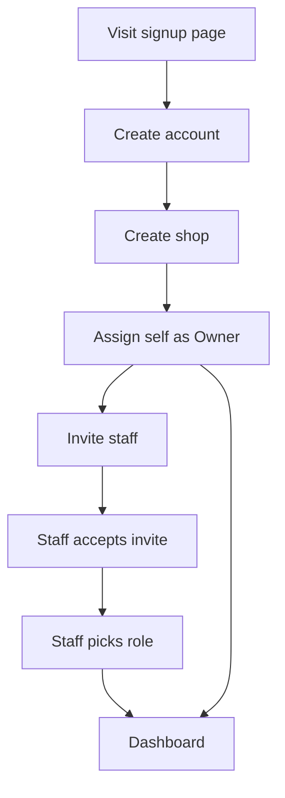
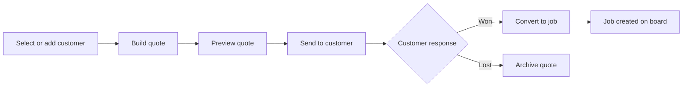
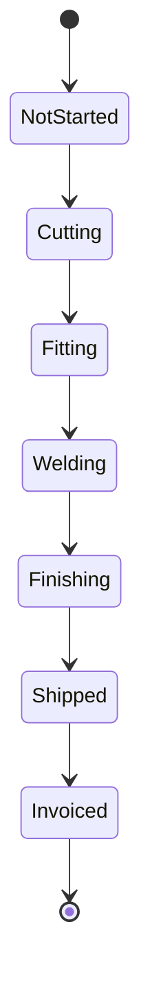
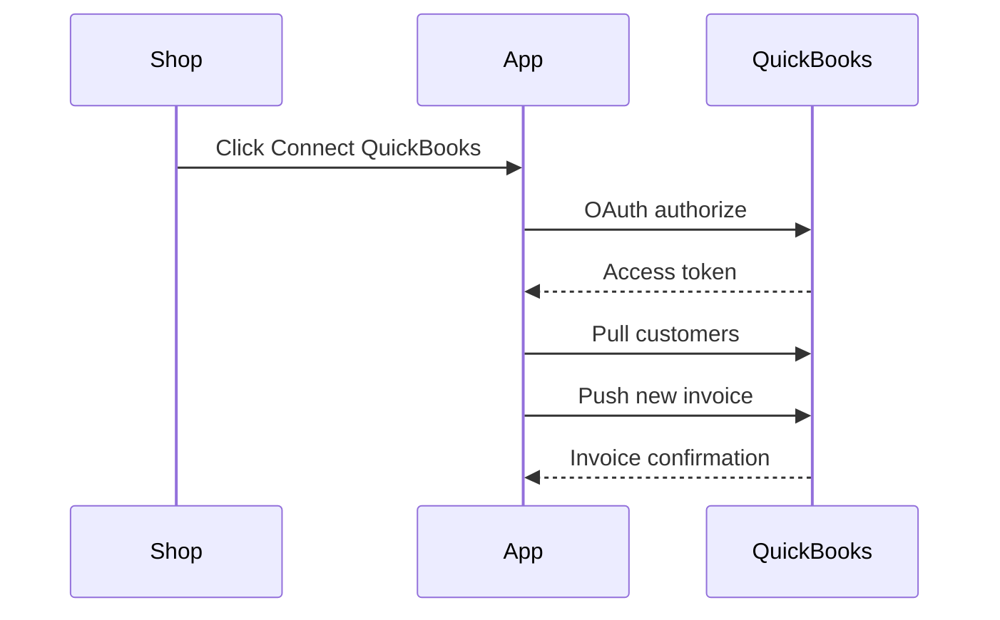

# Build Handoff

A self-contained brief for a fresh session to pick up and implement Scenario B.

## Product

We're building a vertical SaaS quoting, job-tracking, and invoicing tool for small custom/ornamental/mobile metal fabrication and welding shops (1-8 people) - replacing the QuickBooks-plus-spreadsheets-plus-paper-traveler status quo documented in the Pain points tab.

Core features, in plain terms (full dependency table is below):

- **Customers** - contact records that quotes and jobs attach to
- **Quote builder (F1)** - custom quoting with material, labor, and markup
- **Quote-to-job conversion (F2)** - turns a won quote into a trackable job, generates and sends the PDF
- **Job/traveler status board (F3)** - live tracking from cut through ship
- **QuickBooks Online sync (F4)** - customers and invoices sync automatically
- **Subscription billing (F0.8)** - the shop pays for the product itself
- **Material/scrap tracking (F5), mobile/PWA + API (F6), weld/qualification records (F7)** - the Scenario C follow-on

**Dependency shape, in plain terms:** Foundation (accounts, shops, roles) has to exist before anything else - nothing else can start until it's done. Customers have to exist before Quotes can be created. Quotes have to exist before a Quote can become a Job. Jobs have to exist before the status board, material tracking, weld records, or mobile status views have anything to show. Subscription billing and QuickBooks sync are the two features that don't block, or get blocked by, that chain - each can be built independently once its own light prerequisite (the Shop model; stable Customer/Quote data shapes) is in place.

## Tech stack & conventions

- **Backend:** Laravel 13 (PHP 8.3+), one monolithic app.
- **Frontend:** Inertia.js + React + TypeScript, server-driven routing (no separate SPA router). Tailwind CSS for styling.
- **Database:** PostgreSQL. Single database, shared schema - every tenant-owned table carries a `shop_id` foreign key.
- **Tenancy enforcement:** a `BelongsToShop` trait + Eloquent global scope applied to every tenant-owned model, keyed off the authenticated user's `shop_id`. Never rely on manually adding `->where('shop_id', ...)` at each call site - the global scope is the one place that guarantees no cross-tenant leak. Write a test early that asserts a user from Shop A cannot read/write Shop B's records, and run it against every new tenant-owned model.
- **Auth:** Laravel's built-in session-based auth for the web app (Breeze's Inertia+React+TypeScript starter kit is the fastest correct starting point - use it rather than hand-rolling login/register/password-reset).
- **Roles:** Owner, Admin, Staff per shop, from day one (a shop is rarely one person). A user can belong to more than one shop only if that need shows up later - assume one shop per user for MVP.
- **API readiness (for future mobile, per your stated preference):** install Laravel Sanctum and create an empty `routes/api.php` with a versioned prefix (`/api/v1/...`) from the start, but do not build out full parallel API endpoints for every feature now. Add an API endpoint only when a real consumer (the mobile app, or an integration) needs it. This keeps the fast Inertia-only path for now while making the later addition purely additive, not a restructure.
- **Background jobs:** Redis-backed queues for anything slow or external (PDF generation, outbound email, QuickBooks sync calls).
- **Real-time updates:** Laravel Reverb (or Pusher) for broadcasting job/traveler status changes to the board live, instead of polling - keeps the request volume in line with the load estimate in the Architecture tab.
- **File storage:** Laravel's filesystem abstraction from day one, pointed at local disk in dev and S3-compatible storage in production (job photos, generated quote PDFs).
- **Testing:** Pest. Every tenant-scoped model gets a cross-tenant-isolation test as a baseline, not an afterthought.
- **Code style:** Laravel Pint, run in CI (or pre-commit) from the first commit.

## Subscription tiers & feature gating

Starting proposal, mapped to the pricing in the Product & Launch Plan tab - adjust the exact feature split freely, the mechanism below works regardless of where you draw the lines.

### Tier x feature matrix

| Feature | Free (trial) | Start-up | Pro |
| --- | --- | --- | --- |
| Customers, Quote builder, Quote-to-job, Job/traveler board | Full access for 14 days, then locked | Included | Included |
| QuickBooks Online sync | Locked | Not included | Included |
| Material/scrap tracking | Locked | Not included | Included |
| Weld/qualification records | Locked | Not included | Included |
| Mobile/PWA + API access | Locked | Not included | Included |
| User seats | 1 (trial) | Up to 5 | Up to 20 |

"Locked" means: the trial shop can use it during the 14 days like a Pro shop would, so they feel the full product before deciding; once the trial ends without a paid plan, those routes/UI become disabled (read-only where there's existing data, not deleted).

### Backend design

- **`Plan` model** - `key` (free/start-up/pro), `name`, `stripe_price_id`, `user_limit`. Seeded, not hardcoded in controllers.
- **`Feature` enum** (PHP 8 backed enum) - one case per gatable feature: `Customers`, `QuoteBuilder`, `JobBoard`, `QuickbooksSync`, `MaterialTracking`, `WeldRecords`, `MobileApi`.
- **`plan_feature` pivot table** - maps which `Feature` cases each `Plan` includes. A pivot table rather than a hardcoded JSON blob on the model, specifically so which features belong to which tier is data you can change (via a seeder or a simple admin screen later) without a code deploy - this is the "backend should allow defining which features are supported for which tier" part of the ask.
- **`Shop`** gets `plan_id` and a nullable `trial_ends_at`.
- **`Shop::hasFeature(Feature $feature): bool`** - the single source of truth every other check calls: true if the feature is in the shop's current plan, OR the shop is still inside `trial_ends_at` (trial shops get every Start-up + Pro feature during the trial window). This makes trial expiry a computed check, not a data mutation - nothing needs to change on the Shop record when a trial lapses, which keeps the logic simple and easy to reverse if they pay late.
- **Enforcement, two layers:** a Laravel `Gate`/middleware (`EnsureFeatureEnabled:quote-builder`) on the backend routes so a locked feature can never be reached even by a direct request; and an Inertia shared prop (`enabledFeatures: string[]`, set in `HandleInertiaRequests`) so the React frontend can show a grayed-out nav item with an upgrade prompt instead of a broken 403 after the click.
- **Trial expiry job:** a daily scheduled command checks for shops past `trial_ends_at` still on the free plan and, since gating is computed rather than stored, this job's real job is just sending the "your trial ended" notification/email - not changing any access-control data.

Build F0.9 (this) right after F0.8 (billing) and before F1 - every feature from F1 onward should call `Shop::hasFeature()` as part of its own build, not receive gating bolted on afterward.

## Feature build order (dependency hierarchy)

Each feature lists what it needs already built. Build strictly top-to-bottom within a chain; features on the same row of the parallel table below can run out of order relative to each other.

| Order | Feature | Depends on | What it delivers |
| --- | --- | --- | --- |
| F0 | Foundation: Laravel 13 + Inertia + React scaffolding, Shop model, tenant scoping (global scope), User-Shop relationship, roles (Owner/Admin/Staff), base auth (Breeze), base layout/nav | None | Every other feature builds on this - do not parallelize anything against F0 |
| F0.5 | Customers CRUD (name, contact info, address, notes) | F0 | Quotes need a customer to quote against |
| F0.8 | Subscription billing (Stripe Cashier: the shop subscribes to your product) | F0 | Needed before you can actually charge anyone - independent of the fabrication-specific features, so it's a parallel candidate (see below) |
| F0.9 | Feature gating / entitlements (Plan/Tier model, feature registry, trial handling) | F0.8 | Backend + frontend plumbing to lock/unlock features by tier - build before F1 so every feature after it is gated from the start, not retrofitted |
| F1 | Quote builder: material + labor + markup, live/manual pricing, margin calc | F0, F0.5, F0.9 | The #1 pain point from the research - the core wedge feature |
| F2 | Quote -> job conversion, PDF generation, email send | F1 | Turns a won quote into a trackable job |
| F3 | Job/traveler status board (cut -> fit -> weld -> finish -> ship), live updates via broadcasting | F2 | Replaces the whiteboard; the daily-use screen for the shop floor |
| F4 | QuickBooks Online sync (customers, invoices) | F0.5, F1 (data model needs to be stable; doesn't strictly need F2/F3) | Removes the QuickBooks re-entry pain flagged repeatedly in research |
| F5 | Material/scrap tracking tied to job cost | F3 | Real per-job margin - the natural upsell after F1's estimate vs. actual |
| F6 | Mobile/PWA shell + Sanctum-based API endpoints for job status | F3 (for the data it displays), Sanctum scaffolding from F0 | First real use of the API-readiness groundwork from F0 |
| F7 | Weld/qualification record tracking (WPS/PQR, certs tied to jobs) | F3 | Compliance/liability differentiator vs. generic tools |

F1 through F7 should each check their own entitlement via F0.9's feature gate before exposing their UI/API - this is a cross-cutting concern like tenant scoping, not a per-feature afterthought.

This matches the MVP cut line from the Product & Launch Plan tab: **F0 through F3 (plus F0.5 and F0.8) is Scenario B.** F4 rounds it out. F5-F7 are the Scenario C follow-on.

## Work that can run in parallel (multiple agents)

F0 is a hard serial blocker - nothing else should start before it's done and merged, since every feature touches the tenant-scoped models and auth it sets up.

After F0 lands, these can run concurrently:

| Parallel group | Features | Why they're independent |
| --- | --- | --- |
| Group 1 | F0.5 Customers CRUD, F0.8 Subscription billing | Neither touches the other's tables or UI; billing only needs the Shop model from F0 |

After F0.5 lands (F0.8 can still be finishing on its own track):

| Parallel group | Features | Why they're independent |
| --- | --- | --- |
| Group 2 | F1 Quote builder | Blocking - F2/F3/F4 all wait on this, so keep it a single focused effort rather than splitting it further |

After F1 lands:

| Parallel group | Features | Why they're independent |
| --- | --- | --- |
| Group 3 | F2 Quote-to-job conversion, F4 QuickBooks sync (customer/invoice data model + OAuth scaffolding) | F4 needs F1's data shapes to exist but doesn't need F2's job-conversion logic to start the QuickBooks OAuth flow and mapping work |

After F2/F3 land:

| Parallel group | Features | Why they're independent |
| --- | --- | --- |
| Group 4 | F5 Material/scrap tracking, F7 Weld/qualification tracking, F6 Mobile/PWA shell | All three attach to the Job model from F3 but don't modify each other's tables or touch overlapping UI surfaces |

Practical note: even where features are technically independent, they'll often touch the same handful of shared files (the main nav, the Job model's relationships). Keep those shared touchpoints small and agree on them upfront, or the parallelism creates as much merge overhead as it saves.

## Package list (Composer, Laravel 13 project)

| Package | Serves | Purpose |
| --- | --- | --- |
| `laravel/framework` (^13.0) | All | Base framework |
| `laravel/breeze` | F0 | Inertia+React+TypeScript auth scaffolding (login, register, password reset) - fastest correct starting point, don't hand-roll this |
| `inertiajs/inertia-laravel` | All | Server-side Inertia adapter connecting Laravel routes/controllers to the React frontend |
| `tightenco/ziggy` | All | Exposes Laravel named routes to the React frontend so links/redirects don't hardcode URLs |
| `laravel/sanctum` | F0 (scaffolding), F6 (used) | Token-based API auth - installed at F0 for future-readiness, actually used starting at F6 for the mobile/API work |
| `spatie/laravel-permission` | F0 | Roles (Owner/Admin/Staff) and permission checks per shop |
| `laravel/cashier` + `stripe/stripe-php` | F0.8 | Subscription billing - charges shops for the product itself (separate from any in-app payment collection your customers' customers might pay) |
| `barryvdh/laravel-dompdf` | F2 | Generates the quote PDF sent to the customer |
| `spatie/laravel-medialibrary` | F2, F3, F5, F7 | File/photo attachments - quote PDFs, job-progress photos, and later weld/qualification documents |
| `intervention/image` | F3 | Resizes/optimizes job photos before storage, used alongside medialibrary |
| `laravel/reverb` | F3 | WebSocket broadcasting so the job/traveler board updates live across users instead of polling |
| `guzzlehttp/guzzle` | F4 | HTTP client underlying the QuickBooks OAuth flow and API calls |
| `webhook-relay` or Intuit's official `quickbooks/v3-php-sdk` | F4 | QuickBooks Online API client - evaluate both at F4 build time, the Intuit SDK is more official but heavier; a thinner community wrapper may be faster to integrate |
| `spatie/laravel-activitylog` | F3, F7 | Audit trail on job status changes and quote/job edits - useful for trust and for the compliance angle in F7 |
| `laravel/horizon` | All (ops) | Dashboard for monitoring the Redis-backed queues (PDF generation, QuickBooks sync, email) - install once queues exist at F2 |
| `laravel/pulse` | All (ops) | Lightweight production performance monitoring - cheap visibility for a solo operator, install closer to launch |
| `laravel/telescope` | All (dev only) | Local debugging/request inspection - dev environment only, not production |
| `laravel/pint` | All | Code style enforcement |
| `pestphp/pest` + `pestphp/pest-plugin-laravel` | All | Testing framework - write the cross-tenant isolation test from F0 first |
| `laravel/tinker` | All | REPL for local debugging |

### Frontend (npm) companions, briefly

`react`, `react-dom`, `@inertiajs/react`, `typescript`, `tailwindcss` are the baseline. Add `@shadcn/ui`-style component primitives or a lighter component kit as needed once the job board (F3) UI work starts - not worth pinning down before then.

## User flow diagrams

Each diagram below maps directly to test cases: a decision branch is an acceptance-test scenario, and each state transition is a state-transition test.

### Onboarding & auth (F0)

Acceptance cases this implies: signup with an existing email, invite acceptance with an expired token, a Staff role attempting an Owner-only action.

### Quote to job lifecycle (F1-F2)

Acceptance cases: a quote with zero line items cannot send; converting an already-converted quote is blocked; an archived quote can be reopened.

### Job/traveler status board (F3)

Acceptance cases: a job cannot skip from Cutting straight to Shipped without passing through the intermediate states (unless you decide to explicitly allow a manual override - flag that decision to the build session rather than assuming it). Each arrow is a state-transition unit test on the Job model.

### QuickBooks sync (F4)

Acceptance cases: OAuth token expiry mid-sync, a customer that already exists in QuickBooks (dedupe, not duplicate), a push that fails and needs retry rather than silently dropping the invoice.
